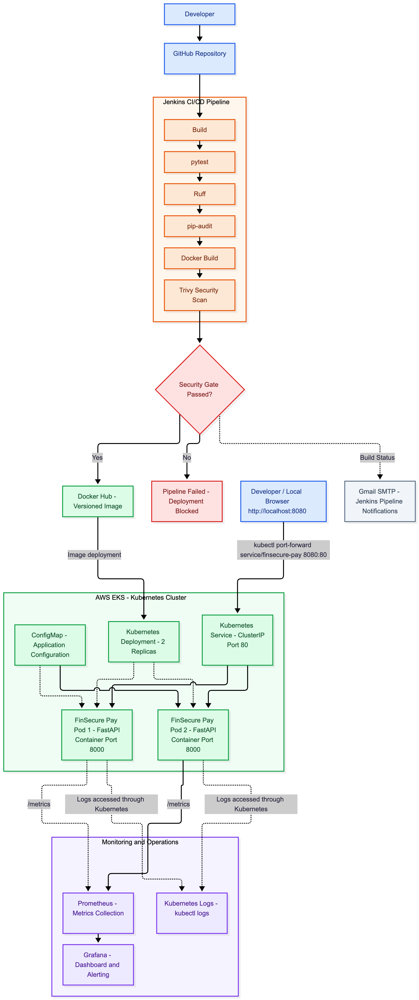

# FinSecure Pay – DevOps Capstone Design Document

## 1. Project Overview

FinSecure Pay is a Python FastAPI-based transaction validation application developed as part of the NUS DevOps Capstone project.

The objective is to implement an end-to-end DevOps workflow covering application development, version control, containerisation, cloud deployment, CI/CD automation, security integration, monitoring, alerting and logging.

**GitHub:** https://github.com/ashwinip21/finsecure-pay

**Docker Hub:** https://hub.docker.com/r/ashwinip21/finsecure-pay

### Technology Stack

- Application: Python 3.12, FastAPI and Pydantic
- Testing: pytest
- Code quality: Ruff
- Dependency security: pip-audit
- Containerisation: Docker
- Container security: Trivy
- Source control: Git and GitHub
- CI/CD: Jenkins
- Cloud platform: AWS
- Container orchestration: Kubernetes on AWS EKS
- Deployment: Kubernetes manifests and Helm
- Monitoring: Prometheus and Grafana
- Notification: Jenkins email notification using Gmail SMTP

All six implementation tasks have been completed and validated. Supporting screenshots, pipeline outputs, security reports and operational evidence are maintained for the final submission.

## 2. End-to-End Architecture

The solution uses an automated source-to-deployment workflow, integrating application development, CI/CD automation, containerisation, cloud deployment, security scanning and operational monitoring.

### Architecture Diagram

### Application and Deployment Architecture

The FastAPI application provides transaction validation and health-check endpoints. Prometheus instrumentation exposes application metrics through the /metrics endpoint.

Docker packages the application and its dependencies into a container image. Jenkins builds and scans the image before publishing it to Docker Hub.

The application is deployed to AWS EKS using Kubernetes Deployment and Service resources.

The Deployment maintains two application replicas. The ClusterIP Service exposes port 80 internally and forwards requests to container port 8000.

### Monitoring Architecture

Prometheus collects application metrics through the configured ServiceMonitor.

Grafana uses Prometheus as its data source and provides dashboards for application availability, HTTP request activity, HTTP errors and CPU utilisation.

Grafana alerting evaluates application availability. Alert testing was performed by temporarily scaling the application Deployment to zero replicas.

The monitoring installation also includes Alertmanager, kube-state-metrics and Node Exporter.

Application logs are accessed through Kubernetes using kubectl logs.

## 3. Major Technology Choices and Design Decisions

### FastAPI and Python

Python and FastAPI were selected to provide a lightweight REST API with structured request validation.
Pydantic validates transaction data, while pytest provides automated application testing.
FastAPI and pytest instead of the recommended Spring Boot, Maven and JUnit 5 are used. These Python alternatives provide equivalent application development, dependency management and automated testing capabilities. Ruff provides code-quality checks, while pip-audit performs Python dependency vulnerability auditing. The selected tools support the same intended DevOps objectives within the Python application environment.

### Docker

Docker provides a reproducible application runtime and separates application dependencies from the host environment.

The application image uses Python 3.12 slim and a non-root application user.

The image is built for the linux/amd64 architecture to support the AWS EKS deployment environment.

### Jenkins

Jenkins automates the CI/CD lifecycle.

The pipeline includes source checkout, application build, automated tests, code-quality checks, dependency auditing, container building, image security scanning, registry publishing and Kubernetes deployment.

The pipeline uses sequential stages so that a failure in a required stage prevents subsequent deployment stages from executing. Deployment verification is performed using Kubernetes rollout status.

### AWS EKS and Kubernetes

AWS EKS provides managed Kubernetes control-plane functionality.

Kubernetes Deployment manages application replicas, while the ClusterIP Service provides internal application networking.

Two application replicas improve availability and allow Kubernetes to replace failed pods.

### Prometheus and Grafana

Prometheus was selected for metrics collection and querying. Grafana provides dashboards and alert evaluation.

The kube-prometheus-stack Helm installation provides Prometheus, Grafana, Alertmanager, kube-state-metrics and Node Exporter.

## 4. Security Considerations

Security is integrated into the CI/CD pipeline.

The implementation includes:

- Ruff for source-code quality checks.
- pip-audit for Python dependency vulnerability auditing.
- Trivy for container image vulnerability scanning.
- A security gate that blocks images containing unfixed HIGH or CRITICAL findings.
- Jenkins credentials for Docker Hub authentication.
- Secure Jenkins SMTP credential configuration for email notifications.
- A non-root user inside the application container.
- Kubernetes-based application deployment and isolation.

Sensitive credentials must not be committed to GitHub or included in application source code.

The Docker image is published to Docker Hub only after the required pipeline checks pass.

Jenkins pipeline email notifications are configured using Gmail SMTP. 
A successful pipeline execution generated a notification containing the project name, build number, build status and build URL. 
Jenkins SMTP credentials are stored securely in Jenkins configuration.

## 5. Recovery and Resilience Considerations

Kubernetes Deployment maintains the desired number of application replicas.

If an application pod is deleted or fails, Kubernetes reconciliation can create a replacement pod to restore the desired replica count.

The application health endpoint provides a basic health verification mechanism.

The Jenkins deployment stage uses kubectl rollout status to verify that a new deployment completes successfully.

Kubernetes Deployment revision history supports manual rollback to a previous known-good version using kubectl rollout undo deployment/finsecure-pay. 
The rollback procedure was demonstrated and followed by rollout verification.

Monitoring supports operational recovery by identifying application unavailability and providing visibility into application behaviour.

During monitoring validation, the application was temporarily scaled to zero replicas to simulate an outage. 
The Grafana alert transitioned from Normal to Pending and then Firing. The Deployment was subsequently restored to two replicas. 
Automated rollback remains a future improvement requiring separate validation.

## 6. AI Application – AI-Assisted DevOps Incident Analysis

### Problem AI Would Address

Cloud-native applications generate operational information across application logs, infrastructure metrics, deployment records and security reports.

During an incident, engineers must manually correlate these sources to identify possible causes.

An AI-assisted incident analysis capability could help summarise operational events and suggest relevant troubleshooting actions.

### Proposed AI Solution

The proposed solution is an AI-assisted DevOps troubleshooting assistant for FinSecure Pay.

When an application availability alert occurs, the assistant could analyse selected operational information and generate an incident summary.

### Example Incident Scenario: 
If Grafana detects application unavailability, the proposed AI assistant could analyse the alert timestamp, Kubernetes pod status, recent events, selected application logs and Jenkins deployment history. It could generate an incident summary, identify possible contributing factors and recommend investigation steps. An engineer would review the recommendations before taking operational action.

### Required Inputs

- Prometheus metrics, including application availability and HTTP request rates.
- Grafana alert details and timestamps.
- Kubernetes pod status and recent events.
- Application logs retrieved using kubectl.
- Jenkins build status and deployment history.
- Relevant Trivy and dependency audit summaries.

### Expected Operational Benefits

- Faster initial incident investigation.
- Easier correlation of application and infrastructure events.
- More consistent troubleshooting recommendations.
- Reduced manual effort when reviewing logs.
- Improved incident documentation and knowledge sharing.

### Limitations, Risks and Governance

AI-generated explanations may be inaccurate or incomplete.

Recommendations must be reviewed by an engineer before operational action is taken.

Sensitive information, credentials, account identifiers and personal data must be excluded or redacted before sending operational information to an AI service.

Access controls, auditability, data retention and organisational AI policies must be considered.

The assistant should initially operate in a read-only advisory role. Automated production remediation is outside the proposed initial scope.

### Proposed Integration

The AI capability could integrate with the existing monitoring architecture.

Prometheus and Grafana would identify incidents. A controlled integration service could collect selected metrics, alert information, Kubernetes events and application logs.

The selected information could then be submitted to an approved AI service for incident summarisation and troubleshooting recommendations.

No production AI model is currently implemented. This is a proposed future enhancement and does not require additional infrastructure for the current Capstone implementation.

## 7. Lessons Learned and Future Improvements

### Lessons Learned

The project demonstrated the importance of integrating testing and security checks into the CI/CD process.

Containerisation improved deployment consistency, while Kubernetes provided application replica management and recovery capabilities.

Prometheus and Grafana demonstrated how application metrics can be used for operational visibility and alerting. The monitoring exercise also highlighted the distinction between alert detection and automated recovery.

The project also highlighted the importance of secure credential management, deployment verification and systematic troubleshooting.

### Future Improvements

- Implement and validate automated deployment rollback.
- Introduce more comprehensive application and infrastructure alerts.
- Integrate Grafana alert notifications with an appropriate contact point.
- Improve application and infrastructure logging.
- Implement the proposed AI-assisted incident analysis capability.
- Introduce automated end-to-end integration testing.
- Review container and dependency vulnerabilities regularly.

## 8. Conclusion

FinSecure Pay demonstrates an end-to-end cloud-native DevOps workflow using GitHub, Jenkins, Docker, AWS EKS, Kubernetes, Prometheus and Grafana.

The solution integrates application testing, security scanning, automated deployment, monitoring, alerting and troubleshooting.

The proposed AI-assisted incident analysis capability provides a practical future enhancement to improve operational investigation while maintaining human oversight and security governance.
